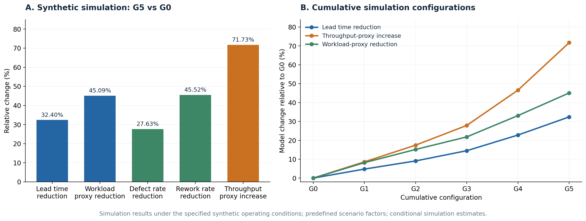

# Data Driven Value Stream Mapping and Design

**Event-log diagnostics, activity-network analysis, and Monte Carlo scenarios for future-state design.**

Research software accompanying *A Closed-Loop Data-Driven Framework for Value Stream Mapping and Future-State Design* by Edwin Montes-Orozco and colleagues.

[](https://github.com/emontes200892/data-driven-vsm-vsd-framework/actions/workflows/ci.yml)

The project reconstructs process indicators from event logs, evaluates diagnostic classifiers with training-derived network features, and compares predefined operating scenarios. The repository includes the exact prepared inputs, calculated outputs, statistical protocols, and figure-generation code.

## Quick start

Use Python 3.12 in an isolated environment. The pinned dependencies describe the numerical environment used for reproduction; GPU hardware is not required.

```bash
git clone https://github.com/emontes200892/data-driven-vsm-vsd-framework.git
cd data-driven-vsm-vsd-framework
python3 -m venv .venv
source .venv/bin/activate
python -m pip install -r requirements.txt
python reproduce.py --stage verify
python reproduce.py
```

The full run recalculates the synthetic diagnostics, six scenarios, three prepared event-log benchmarks, activity controls, seed-blocked statistics, tables, and figures. It verifies input hashes first and leaves the input CSV files unchanged. Computation runs on the CPU and writes to `results/`.

For an individual part of the workflow:

```bash
python reproduce.py --stage scenarios
python reproduce.py --stage statistics
python reproduce.py --stage figures
python reproduce.py --dry-run
python -m unittest discover -s tests -v
```

See [Reproduction](docs/reproduction.md) for stages, output locations, and dependency details.

## Included experiments

| Experiment | Inputs | Outputs |
|---|---|---|
| Synthetic manufacturing diagnostics | 8,532 events, 1,200 cases, 8 activities | Operational KPIs, activity networks, diagnostic classifiers |
| BPI2017 diagnostics | 250,000 prepared events | Training-derived network features and current-event label classification |
| BPI2019 diagnostics | 250,000 prepared events | Network features, operational proxies, and activity controls |
| Data Quality Issues diagnostics | 8,607 prepared events | Event-log indicators and diagnostic comparisons |
| Scenario analysis | Six configurations, 30 seed blocks, 500 sampled orders per run | KPI summaries, paired comparisons, bootstrap intervals |

Dataset counts refer to the included prepared inputs. The benchmark names do not imply that the generic XES adapter recreates their preparation history. Read [Data](docs/data.md) before interpreting the operational variables.

## Scenario results

| Indicator | G5 relative to G0 |
|---|---:|
| Sampled lead time | 32.40% reduction |
| Workload proxy | 45.09% reduction |
| Defect rate | 27.63% reduction |
| Rework rate | 45.52% reduction |
| Calendar-based throughput proxy | 71.73% increase |

These changes are conditional responses to predefined scenario factors. They are not measured improvements in a physical factory or estimated causal effects of adding analytical modules.



## Diagnostic interpretation

The classifiers describe labels attached to the current recorded event. For BPI2017, the prepared rework label identifies `O_Returned`; an activity-only control also attains F1 = 1.0000. High diagnostic separation therefore does not demonstrate advance prediction of future rework or a unique benefit of network structure. Chronological row splits may share cases across partitions.

The implemented experiments use activity-transition graphs and offline scenario sampling. Explanation-driven intervention selection, resource-constrained simulation, live digital-twin synchronization, and physical feedback are extensions of the proposed architecture. The evaluated scope and formulas are described in [Methodology](docs/methodology.md).

## Repository guide

| Path | Purpose |
|---|---|
| `src/` | Numerical analysis and diagnostic controls |
| `scripts/` | Figure rendering |
| `data/` | Synthetic log and route parameters |
| `datasets/prepared/` | Exact prepared benchmark inputs |
| `datasets/input_manifest.json` | Expected sizes and SHA-256 hashes |
| `results/` | Computed results, controls, statistics, tables, and figures |
| `results/reference/` | Historical numerical outputs for comparison |
| `docs/` | Data definitions, methods, and reproduction guide |
| `tests/` | Input, timestamp, and numerical consistency checks |
| `reproduce.py` | Stage-based execution entry point |

## Citation and reuse

Use [CITATION.cff](CITATION.cff) for software citation metadata. The associated research manuscript is:

Montes-Orozco, E., Dopslaf, M., Mora-Gutiérrez, R. A., de-los-Cobos-Silva, S. G., Rincón-García, E. A., Lara-Velázquez, P., and Gutiérrez-Andrade, M. Á. (2026). *A Closed-Loop Data-Driven Framework for Value Stream Mapping and Future-State Design*.

See [Reuse](docs/reuse.md) for software and dataset terms. Questions and reproducibility reports can be raised through [GitHub Issues](https://github.com/emontes200892/data-driven-vsm-vsd-framework/issues).
